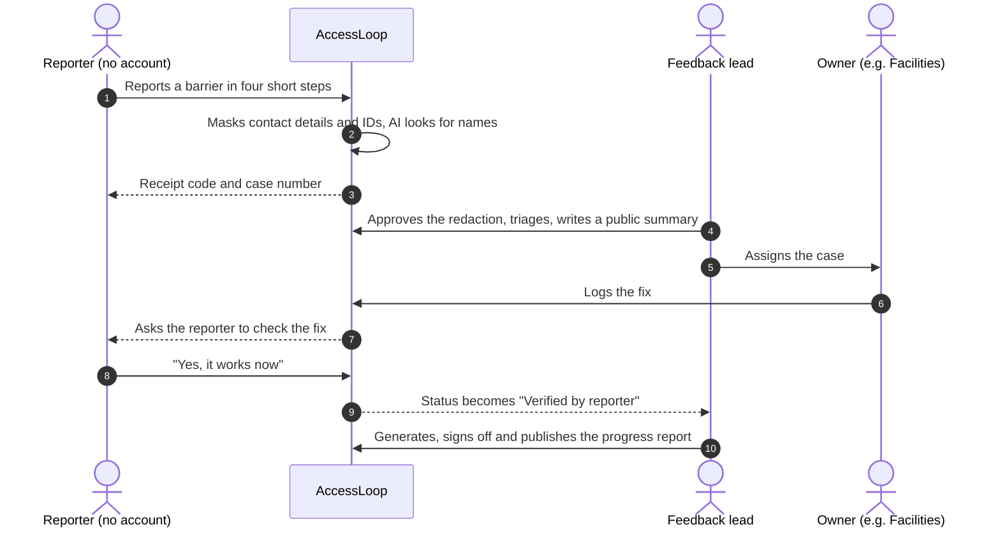

# AccessLoop

[](https://github.com/AccessLoopAI/AccessLoop/actions/workflows/ci.yml)

**A barrier is fixed when the person who reported it says so.**

AccessLoop is a feedback system for the Accessible Canada Act. Anyone can report an accessibility barrier, whether it's a website, a building, a phone line or a policy, without making an account. The case is closed only when that person confirms the fix works. AccessLoop then drafts the Feedback section of the organization's required progress report from those records, and links every sentence to its evidence.

> **Status:** a local prototype built for Build North 2026. It runs on one computer with no accounts. The AI is simulated, email goes to an on-screen Outbox, and the organizations in the demo data are made up.

## Why it exists

Federally regulated organizations in Canada (banks, telecoms, airlines, federal departments) must accept feedback about barriers, acknowledge it, keep it for seven years and report on it under fixed headings (ACA s. 70, ACR ss. 9, 14 and 19). Inspections found more problems in feedback-process descriptions than anywhere else. Most tools stop at "ticket closed". AccessLoop follows each barrier until the person who met it says it's gone.

## How it works



- **No account for reporters.** People get a receipt code. They can check the AI summary of their words and change it, or opt out of AI entirely.
- **Privacy before AI.** Fixed rules mask contact details and ID numbers before any AI call, and the lead approves what's hidden before an owner sees the case.
- **Only the reporter can verify.** Staff can't mark a case "Verified by reporter". That status comes only from the reporter's answer, given with their receipt code.
- **A report you can check.** The AI rewords only template sentences built from counted facts, and a validator rejects any number that isn't in the cited records.
- **Tamper-evident records.** Each case history is a hash chain the database won't let anyone edit. `/verify` re-runs the checks behind a published report, and `tools/verify-bundle.mjs` runs them offline.
- **Accessible by design.** It targets WCAG 2.2 AA everywhere, uses native HTML controls, and checks every page with axe in CI.

## Quick start

You need **Node.js 22** and free ports 3000 and 54329. No Docker, accounts or API keys.

```bash
git clone https://github.com/AccessLoopAI/AccessLoop.git
cd AccessLoop
npm install
npm run local
```

The first run creates `.env.local`, starts a bundled Postgres, then migrates and seeds it, and serves the app at **http://localhost:3000**. Press Ctrl+C to stop everything, and run `npm run local:reset` for fresh demo data.

The seed prints a receipt code for case BAR-0014 in the terminal. Copy it, because it can't be shown again.

> On Linux, run as a normal user, not root, with the `en_US.UTF-8` locale installed. The bundled Postgres needs both.

## Try the demo

1. **Report** a barrier at `/o/maple-harbour/report` and keep the receipt code.
2. **Triage** it: go to `/sign-in`, choose **Alex Rivera** (the lead), open the case from Inbox, approve the redaction, save the triage and assign it to **Facilities team**.
3. **Fix** it: sign in as **Facilities team**, open the case from My work and press **Log fix**.
4. **Verify** it: open `/r/{your code}`, answer **"Yes, it works now"**, and the case becomes "Verified by reporter".
5. **Report** on it: as Alex Rivera, open **Reports → New report → Generate draft**, open a sentence's sources, then press **Verify evidence chain**.

In a hurry? BAR-0014 is already waiting for its reporter. Open `/r/{the seeded code}` and start at step 4.

## Testing

| Command | Checks |
|---|---|
| `npm run typecheck`, `npm run lint` | TypeScript (strict) and ESLint |
| `npm test` | Unit tests (Vitest): state machine, hash chains, redaction, metrics, report validator, API |
| `npm run db:smoke` | Row-level security, triggers and guards on an in-memory Postgres |
| `npm run e2e` | Playwright on a production build, with axe accessibility checks on every page (run `npx playwright install chromium webkit` once first) |

CI runs all of these on every push to `main`. On pull requests the end-to-end suite runs only when the PR has the `e2e` label.

## Tech stack

Next.js 16 (App Router, TypeScript) · Tailwind CSS · Postgres with row-level security per organization · Drizzle ORM · Anthropic Claude (simulated in this build) · Playwright + axe · Expo reporter app in [`mobile/`](mobile/README.md)

## Limits

- **No real AI yet.** Every AI answer here is simulated, and the eval numbers only test the harness.
- **Not hosted.** Staff sign-in is local-only, and Clerk, Vercel, Supabase and real email come at launch ([docs/handoff.md](docs/handoff.md)).
- **No outside review yet.** There has been no testing with disabled users, no screen-reader sessions, no security review and no accessibility audit.

## Learn more

| Doc | What's in it |
|---|---|
| [docs/overview.md](docs/overview.md) | Full project overview: the legal background, every feature, architecture, AI evaluation, accessibility, privacy and known gaps |
| [docs/domain.md](docs/domain.md) | The product spec and case state machine |
| [SECURITY.md](SECURITY.md) | Tenancy, encryption, keys and sign-in |
| [docs/decisions.md](docs/decisions.md) | Decision log |

## Team

| Member | Focus |
|---|---|
| Alireza Abedini ([@AlirezaAbedinii](https://github.com/AlirezaAbedinii)) | Platform and AI |
| Mohammadhossein Naderi ([@mh-naderi](https://github.com/mh-naderi)) | Frontend foundation and staff platform |
| Yasin Dehfouli ([@YaCnDehfuli](https://github.com/YaCnDehfuli)) | Data, security and staff workflow |
| Sepehr Ashrafzadeh ([@SepehrAsh](https://github.com/SepehrAsh)) | Reporter experience and reports |
| Amirreza Radjou ([@amirradjou](https://github.com/amirradjou)) | Database operations and mobile UI |

Built with help from Claude Code. The team made the product decisions ([disclosures](docs/overview.md#disclosures)). The code is under the [MIT License](LICENSE). Fonts are under the SIL Open Font License, in `app/fonts/`.
