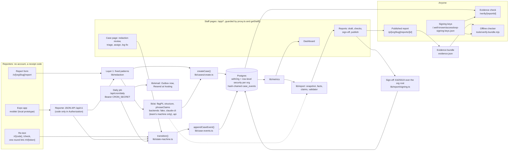

# AccessLoop: full project overview

The detailed reference behind the [README](../README.md): the legal background, every feature, testing, architecture, AI evaluation, accessibility, privacy and the known gaps.

**A barrier is fixed when the person who reported it says so.**

> AccessLoop is the record system for the Accessible Canada Act feedback obligation. Every barrier someone reports, whether a website, a building, a phone line or a policy, is closed only when the person who reported it confirms the fix, and the Feedback section of the required progress report is drafted from those records, each sentence linked to its evidence.

AccessLoop helps you meet your obligations under the Accessible Canada Act. It does not fix anything by itself, and it is not an accessibility overlay. People fix the barriers. AccessLoop keeps the record.

> **Status (October 28, 2026): a local prototype, built for Build North 2026.** It runs on one computer with no accounts. The AI is simulated by default (ready-made answers, `FAKE_LLM=1`); a developer can switch to their own signed-in Claude Code CLI, whose results are internal only. Email is written to an Outbox page, not sent. The three organizations in the demo data are made up. Nothing is hosted yet, and there are no publishable AI numbers yet: there is no API key. Phase 7 (from prototype to shippable product) has built everything that works without accounts; what is left needs accounts and people ([Going live](#going-live-not-done-yet)). See [Limits and roadmap](#limits-and-roadmap).

## The problem

Under the Accessible Canada Act (ACA), federally regulated organizations, such as federal departments, banks, telecom and broadcasting companies and federal transportation providers, must set up a process for receiving feedback about barriers and for dealing with it (ACA s. 70(1), with the same wording in ss. 43, 48 and 57). The Act counts as a barrier anything that hinders the full and equal participation in society of people with an impairment or a functional limitation, whether it is physical, architectural, technological or attitudinal, based on information or communications, or the result of a policy or a practice (ACA s. 2). So AccessLoop takes every kind of barrier, not just websites.

The Accessible Canada Regulations (ACR) say what that process needs:

- **ACR s. 9:** name the person who receives feedback, by position title. Accept anonymous feedback. Accept feedback by mail, phone, email and any other way the organization talks to the public. Acknowledge each piece of feedback the same way it came in, unless it was anonymous.
- **ACR s. 14:** write the progress report in simple, clear and concise language, under the headings "General", one heading for each area of the accessibility plan, "Consultations" and "Feedback". The Feedback section must describe the feedback received and how it was taken into consideration (ACA s. 71(5)).
- **ACR s. 19:** keep the feedback for seven years from the day it is received.

The next progress reports are due **December 31, 2026** (federal public sector) and **June 1, 2027** (large private organizations, 100+ employees).

**What inspections found.** Feedback-process descriptions had the highest number of problems found in inspections, and missing headings and weak reporting on barrier removal were common in progress reports. To be fair about penalties: the obligations AccessLoop touches are classed as minor in ACR Schedule 1, and the Accessibility Commissioner's 2024–25 report says no enforcement actions had been taken yet. So the case for AccessLoop is not fear of fines. It is doing this work well: following each barrier until the person who met it says it is gone, and showing that in the report.

## Who it is for

| Who | What they do in AccessLoop | Account? | In the demo data |
|---|---|---|---|
| **Reporters**: anyone who meets a barrier, often a person with a disability | Report it, check the AI summary, follow its status, say whether the fix works | No. They get a receipt code | You, on the public form |
| **The designated feedback lead** (ACR s. 9(1)) | Checks what was hidden, triages, assigns, logs feedback that came by phone, mail, email or in person, builds and signs off the progress report, edits settings | Staff sign-in | Alex Rivera (Maple Harbour Bank) |
| **Owners**: the teams that fix things, like IT, facilities or HR | See the cases assigned to them, with personal details hidden, and log the fix | Staff sign-in | Web team, Facilities team |
| **Auditors**: internal audit, or a regulator during a demo | Read cases (details hidden) and reports, and run the evidence check. They can't change anything | Staff sign-in | Internal audit |

A second made-up organization, Lakeview Telecom ("Other org lead"), is there to test that one organization never sees another's data. A third, Kestrel Bay Group (lead "Riley Brennan", owner "Operations team"), holds 14 scenario cases, each a barrier theme from a published accessibility progress report, written in our own words and listed with its source on `/sources`. See [Demo logins](#demo-logins).

## What it does

### The loop

```
report → redaction → triage → assign → fix → reporter re-test → verified
```

1. **Report.** The public form at `/o/{org}/report` has four short screens, one question each. It never asks for a name (two of the three follow-up answers keep the reporter anonymous, and none is chosen for them), with no account, no CAPTCHA and no time limit, and the draft is saved in that browser tab (on the device only if the reporter ticks "Keep this draft on this device"). Step 3 is one question, "How can we follow up?". The reporter sees an AI summary next to their own words, and can confirm it, change it or keep their own words instead. They can tick "Don't use AI on my report" there. Before the summary is made (step 3) and again next to that choice, one sentence says where the words go when AI is on, true for the copy that is running: with the real API, "When AI is on, your words go to Anthropic, an AI company in the United States, after we take out contact details and ID numbers."; on this local prototype, that the AI is simulated and the words don't leave this computer. The receipt page shows a receipt code and a reference like BAR-0017. For web feedback, that page is the acknowledgement (ACR s. 9(4)).
2. **Redaction.** Fixed rules mask contact details, an AI step looks for names and other identifying clues, and then the lead checks and approves what is hidden. Owners never see a case before that approval.
3. **Triage and assign.** The AI suggests a priority area. The lead decides, writes a public summary and assigns an owner.
4. **Fix.** The owner writes down what they changed.
5. **Re-test.** If the reporter agreed to be asked, they open `/r/{code}` and answer "Yes, it works now", "Partly", "No, still a barrier", "I can't check right now" or "Don't contact me about this again". "Partly" and "No" send the case back to the owner, for at most 2 rounds.
6. **Verified.** "Yes, it works now" closes the loop, and the status becomes "Verified by reporter". Staff can't set this status. It comes from an answer sent with the reporter's receipt code.

Feedback that arrives by phone, mail, email or in person is logged by the lead ("Log feedback", `/app/cases/new`) and goes into the same loop. Its acknowledgement is recorded in the same way it came in. The Outbox (`/app/outbox`) shows every email that would have been sent.

**QR posters for places.** The lead names the organization's places, phone lines, websites and documents in Settings ("Locations and posters", `/app/settings/locations`) and prints a one-page poster for each. Its QR code (drawn on the server, with the address printed under it for people who can't scan) opens the report form with "Where did it happen?" already filled in; the reporter can change it. A location's ID only ever works for its own organization, and a retired location's posters open an empty form. In local mode the code points at `localhost`, so phones can't open it until the app has a public address.

### The progress report: compiled, not generated

On `/app/reports`, the lead picks a period. AccessLoop then freezes a snapshot of the cases, counts the facts (with the same code as the dashboard), turns each fact into a template sentence, lets the AI reword the sentences in plain language (in this build the simulated AI keeps the templates as they are), and checks every sentence. A reworded sentence is rejected, and its plain template used instead, if it contains a number that is not in the facts it cites or names a case it does not cite. If a sentence cites no records, or even its template fails the checks, the draft can't be signed off. The "Report checks" list runs the ACR s. 14 heading rules.

The lead writes the plan-area and Consultations sections, signs off (after that the report can't change) and publishes it at `/p/{org}/reports/{id}`. Every generated sentence ends with a button, "Sources for this sentence (N records)", that opens the case references and public summaries behind it. A plain-text download is available too.

### The evidence check: `/verify/{reportId}`

Each case's history is a chain of records that can be added to but never edited, and each record carries a hash of the one before it. For a report and every case it cites, `/verify` runs five checks:

1. **Report unchanged:** the snapshot still matches the fingerprint printed in the report's footer.
2. **Records intact:** each case's chain of records verifies.
3. **Report matches records:** replaying each case's records up to the point the report saw gives the same status, area, summary, dates and facts.
4. **Later updates:** how many records were added since (information, not an error).
5. **Signed by AccessLoop at sign-off:** the Ed25519-signed fingerprint over the report, the lead's text and the latest record of every case history still matches what is stored (a draft is "not signed yet").

The same checks run offline, without trusting the server: `node tools/verify-bundle.mjs <evidence bundle> --keys <saved signing keys>` (no dependencies; exit 0 when every check passes).

If anything was edited, the failing check turns red with a plain explanation, and a broken link in a case's chain is drawn in red.

### The dashboard: `/app/dashboard`

The staff home page answers one question: is our feedback loop closing, and are we ready to report? It shows the verified-fix rate as a ring, tiles for median days to a verified fix, open barriers, acknowledgements, reporter corrections to AI summaries and re-test answers, the loop funnel, monthly and per-area charts, intake channels, a "Needs attention" list, and cards for report readiness and evidence integrity. Every number comes from `lib/metrics/`, the same functions the report uses. Each count links to the inbox, filtered to the cases behind it (a zero is plain text), and every chart has a real data table.

### Four signature moments

1. **The verified moment.** When the reporter answers "Yes, it works now", the loop timeline closes into one ring and the badge turns to "Verified by reporter" (with no animation when the device asks for reduced motion).
2. **The report building itself.** "Generate draft" fills the sections in order while the "Report checks" list ticks green. A sentence's sources open beside it.
3. **The evidence chain.** `/verify` draws each case as a chain of linked records with short hash chips. A tampered link turns red. Underneath, it is a real table for screen readers.
4. **The dashboard.** The opening and closing shot of the demo.

## Run it locally

### What you need

- **Node.js 22** with npm. Tested with Node 22.18 on Windows 11, and on Ubuntu 24.04 in CI (the full e2e suite included). The bundled Postgres also has builds for macOS, but we have not tried it there yet.
- Free ports **3000** (the app) and **54329** (the database).
- No Docker, no accounts, no API keys.

### One command

```bash
npm install
npm run local
```

Then open **http://localhost:3000**. Press Ctrl+C to stop the app and the database together.

On its initial run, `npm run local` (`scripts/local.ts`) sets everything up by itself. Later runs keep your data and do not seed again.

1. It writes `.env.local` with random local secrets and the local flags (`AUTH_MODE=local`, `FAKE_LLM=1`, `AI_BACKEND=fake`, `FAKE_EMAIL=1`). It never overwrites a value you set.
2. It starts a real Postgres 17 from `node_modules` (the `embedded-postgres` package), with its data in `.data/pg`.
3. It creates the app's database role `accessloop_app` (no superuser, no row-level security bypass), then applies the migrations and `db/sql/0100_security.sql`.
4. It seeds three made-up organizations: Maple Harbour Bank, with 16 cases from 2026 in every status; Lakeview Telecom, with none (it is there for the isolation tests); and Kestrel Bay Group, with 14 scenario cases based on published reports.
5. It starts `next dev` on 127.0.0.1, port 3000.

The seed prints a line like `BAR-0014 (retest_open) receipt code: XXXX-XXXX-XXXX-XXXX`. Copy that code now: AccessLoop stores a hash of it, never the code, so it can't be shown again.

### Demo logins

Open http://localhost:3000/sign-in. It lists one button per seeded person, named "Sign in as {name} ({organization})", grouped by organization. There are no passwords: this page works only on this computer (`AUTH_MODE=local`, a loopback host, no forwarding header pointing elsewhere, not on Vercel) and is a 404 anywhere else.

| Organization (`/o/{slug}/report`) | Sign in as | Role | Lands on |
|---|---|---|---|
| Maple Harbour Bank (`maple-harbour`) | Alex Rivera | Lead (the designated feedback person) | Dashboard |
| | Web team | Owner | My work |
| | Facilities team | Owner | My work |
| | Internal audit | Auditor (read-only) | Dashboard |
| Lakeview Telecom (`lakeview-telecom`) | Other org lead | Lead | Dashboard |
| Kestrel Bay Group (`kestrel-bay`) | Riley Brennan | Lead | Dashboard |
| | Operations team | Owner | My work |

These are local stand-ins for staff accounts. At hosting, Clerk replaces this page (the same people as Clerk test users; [Going live](#going-live-not-done-yet)), and there are no hosted demo logins yet.

| Command | What it does |
|---|---|
| `npm run local:reset` | Deletes `.data/pg` and sets it all up again with fresh demo data, printing a new receipt code for BAR-0014. Run it before a demo and after the e2e tests. Then start the app with `npm run local` |
| `npm run local:setup` | The setup steps, without starting the app |
| `npm run local:serve` | The database plus a production build (`next build`, then `next start`). The e2e tests use it |
| `npm run local:db` | The database alone, in the foreground |

If something goes wrong:

| Symptom | Fix |
|---|---|
| Port 3000 or 54329 is already in use | Close the other `npm run local` window |
| "path too long" on Windows | Move the folder to a short path, like `C:\dev\accessloop` |
| The demo data looks wrong | `npm run local:reset` |

### Try the demo (about 5 minutes)

1. **Report a barrier** at http://localhost:3000/o/maple-harbour/report. The simulated AI has ready answers for reports that mention "door button", "date picker" or "relay". Any other text gets a summary that says it is simulated. The simulated name check knows just a few made-up names, so to see the redaction step, use the demo test's words (the fixed patterns catch the phone number): *"Hi, my name is Daniel Okafor. The automatic door button at the King Street branch has been broken for three weeks, so I can't get in with my wheelchair. Call me at four one six five five five zero one four two."* At "How can we follow up?", choose "Let me check the fix with my code", press Next, check the summary, send the report and keep the receipt code.
2. **Triage as the lead.** Open http://localhost:3000/sign-in and press "Sign in as Alex Rivera". You land on the dashboard. Open **Inbox**, then your case. The redaction review shows `[PERSON]` and `[PHONE]` where the name and number were. "Show original" works for the lead, and the History records it. Press "Approve redaction", check the area marked "AI suggestion" (with its confidence as high, medium or low), write a public summary, press "Save triage", then assign the case to "Facilities team" (a due date is optional).
3. **Log the fix.** Sign out, sign in as "Facilities team", open the case from **My work**, describe the fix and press "Log fix". The status becomes "Waiting for the reporter to check".
4. **Confirm as the reporter.** Open `http://localhost:3000/r/{your code}`, or go to `/check` and paste the code. Choose "Yes, it works now" and press "Send answer". The case is now "Verified by reporter".
5. **Build the report.** Sign in as Alex Rivera, open **Reports**, press "New report", set the period from 2026-01-01 to 2026-12-31 and press "Generate draft". Open a "Sources for this sentence" button, then follow "Verify evidence chain".

**Shortcut:** the seeded case BAR-0014 is already waiting for its reporter. Open `/r/{code}` with the code the seed printed and answer "Yes, it works now".

Also worth a look: **Outbox** (the emails that would have been sent, including "A barrier was assigned to you" for the owner), **Eval** (the saved, simulated eval runs), **Settings** (the ACR s. 9 checklist and "Locations and posters"), `/p/maple-harbour` (the public feedback page), `/sources` (the published reports the Kestrel Bay scenarios come from), `/trust` (privacy and AI in plain words) and `/accessibility` (our own accessibility notes).

## Mobile app (Expo)

`mobile/` holds the reporter side as an Expo app (iOS, Android and web): choose an organization by its short name
or from a location poster's link (`accessloop://report?org=maple-harbour&loc=...`), the same four steps as the web
form (one question each), the review with "Your words" and the AI summary (confirm, change, keep my words, or
don't use AI), the receipt, "My reports" (receipt codes kept only in expo-secure-store, never in URLs or logs), a
status screen and the re-test with the five answers. It is a local prototype: it talks only to the JSON API at
`/api/v1` on this computer, and it has not been tested on a real phone or with a screen reader yet.

Run it in two terminals (the same commands in PowerShell and bash):

```bash
# terminal 1, in the project root: the web app and its API on http://localhost:3000
npm run local

# terminal 2, in mobile/ (npm install once)
cd mobile
npm install
npx expo start --web              # the app in the browser, http://localhost:8081
npx expo start --localhost        # or: press i (iOS simulator, macOS) or a (Android emulator)
```

On the Android emulator, also run `adb reverse tcp:3000 tcp:3000` so its `localhost:3000` reaches the computer.
`EXPO_PUBLIC_API_URL` changes where the API is (default `http://localhost:3000`; it is read when the bundle is built,
so restart `expo start` after changing it). Stop both with Ctrl+C.

What has been checked: only the Expo **web** build, in a desktop browser at 320 and 375 px, light and dark (axe on
every screen and error state; `mobile/A11Y-TESTING.md`), and once end to end against the real local app and its
`/api/v1` (docs/decisions.md, 2026-10-20). Not yet: a real phone, Expo Go on a phone, a simulator run
recorded here, VoiceOver or TalkBack. The app's AI notice does not yet say where the words go, as the web form now
does (`mobile/src/copy.ts`).

**A real phone on Wi-Fi can't reach the local app.** `npm run local` listens on 127.0.0.1 only, on purpose (the
local sign-in trusts the Host header; see `docs/decisions.md`, 2026-10-19). Use the browser, a simulator or an
emulator until there is a hosted API. The app has its own `package.json` and checks (`mobile/README.md`), and the
root `typecheck`, `lint`, `test`, `e2e` and Vercel builds leave it out. The VoiceOver and TalkBack test script is
`mobile/A11Y-TESTING.md`.

## How to test

| Command | What it checks |
|---|---|
| `npm run typecheck` | TypeScript in strict mode (`tsc --noEmit`) |
| `npm run lint` | ESLint |
| `npm test` | 1339 vitest tests in 82 files: the state machine, hash chains, receipt codes, encryption, redaction patterns, the AI module with stubbed clients and a stubbed CLI (never a real model), metrics against the seed's expected values, report facts and the sentence validator, the `/verify` replay and report signing, the reporter JSON API, rate limits and the daily job, the eval runner and the colour-contrast table. Database tests use an in-process PGlite, so no database server is needed |
| `npm run db:smoke` | 57 checks on an in-memory Postgres (PGlite on port 5544): migrations, security SQL, seed (the scenario org included), hash chains, the trigger that blocks edits to case records, the sign-off lock on reports, row-level security (forced on every table) and guards |
| `npm run e2e` | Playwright against the local production build, with fake AI and email forced (below) |
| `npm run eval` | The AI evaluation harness (see [AI and evaluation](#ai-and-evaluation)) |
| `npm run db:remote-smoke` | 32 of the same row-level security, guard, sign-off-lock and lookup-function checks, read-only, against `DATABASE_URL` as the app role (for a hosted database later; every transaction is rolled back, and it refuses a superuser or BYPASSRLS role) |

The counts are from the last full run, on October 21, 2026 (main after every Phase 7 track was merged).

**Load check** (`npm run load:check`, 50 concurrent clients for 30 s per route; local laptop, production build, fake AI; **not a hosted measurement**):

| Route | p95 |
|---|---:|
| Home, `/` | 32 ms |
| Report form, `/o/maple-harbour/report` | 185 ms |
| Inbox, signed in as the lead (104 cases on one page) | 1285 ms |

From [docs/load-check.md](load-check.md) (October 20, 2026; no errors in 74,161 requests; an independent re-run on a busier laptop reproduced it within that noise). It was measured before the inbox showed 50 cases to a page, and has not been measured again since, nor against any hosted URL.

### End-to-end tests

Once per machine:

```bash
npm run local:setup              # writes .env.local, which the tests read
npx playwright install chromium
```

Then stop any running `npm run local` and run:

```bash
npm run e2e
```

It builds and starts the app itself (`npm run local:serve`), with `FAKE_LLM=1`, `FAKE_EMAIL=1` and `AI_BACKEND=fake` forced, whatever `.env.local` says. It does not reuse an app that is already running unless you set `E2E_REUSE=1`. The full run is 237 tests (209 in Chromium, then the 27 reporter, text-spacing and QR-link tests again in WebKit, plus the setup step) and takes about 15 to 20 minutes on our laptop (one worker, because the specs share one database). It covers:

- **`e2e/demo.spec.ts`, the acceptance test:** one barrier from report to "Verified by reporter", then a checked, cited progress report and its evidence check, in 5 steps, with axe checks along the way (the reporter's screens, the lead's case page, the re-test and the draft);
- the reporter and staff flows, staff-logged intake, the Outbox and settings, inbox filters, reports, and `/verify` with a tampered report (check 1 turns red);
- **security:** one organization's lead sees none of the other's cases; an owner gets a 404 for a case not assigned to them; a receipt code from one organization is a 404 in another's context; the database refuses UPDATE and DELETE on case records; `/sign-in` is a 404 on a non-local host;
- **the dashboard:** every tile compared with `lib/metrics/` run on the same database, and axe at 1440 and 390 px in light and dark;
- **accessibility:** axe (WCAG 2.0, 2.1 and 2.2, Levels A and AA) on every page, in the states the tests check, flows done with the keyboard alone, reflow at 320 px, WCAG 1.4.12 text spacing on the key screens and a simulated Windows contrast theme;
- **QR posters:** a lead adds a location, prints its poster (one page, the QR code holding exactly the printed address), and the poster's link opens a form with the place filled in; editing, retiring, and the walls between roles and organizations (`e2e/locations.spec.ts`; the reporter's side also in WebKit, `e2e/qr-prefill.spec.ts`);
- **the reporter JSON API** for the Expo app (`/api/v1`, docs/domain.md §4.1), request by request: preview, send, status with the code only in the `Authorization` header, re-test, errors and rate limits;
- **WebKit:** the reporter specs, the QR-link spec and the text-spacing check run a second time in WebKit, Safari's engine (install it once with `npx playwright install webkit`);
- **screenshots** of the key screens at 1440 and 390 px, light and dark, saved to `e2e/screenshots/` for people to review (not pixel tests).

The e2e run adds cases to the local database, so run `npm run local:reset` before a demo.

To run the demo test up to one step (1 to 4; leave it unset for all 5):

```powershell
$env:DEMO_UNTIL_STEP=4; npm run e2e -- e2e/demo.spec.ts    # PowerShell (then: Remove-Item Env:DEMO_UNTIL_STEP)
```

```bash
DEMO_UNTIL_STEP=4 npm run e2e -- e2e/demo.spec.ts           # bash
```

### Eval with fakes

`npm run eval` prints a metrics JSON and saves a new file in `eval/results/`. With the default fake backend the file is marked `"simulated": true`: it checks that the harness works, not how good a model is. `--repeats 3` runs the set three times (the page shows the mean, its 95% interval and the range across repeats); `--layer1-only` turns the AI personal-details pass off to compare the fixed patterns alone. On `/app/eval` a measured run is always shown first (an api run before a claude-cli one), and every fake run is labelled "Simulated: fake AI, not a measurement".

## Architecture

Everything below runs on one laptop today; Vercel, Supabase, Clerk, Resend and the Anthropic API come at hosting ([Going live](#going-live-not-done-yet)).



In words:

- **Next.js 16, App Router** (TypeScript strict, Tailwind CSS, native HTML elements). Public reporter pages, plus staff pages under `/app/*` that `proxy.ts` protects. Every page and route handler that touches the database, crypto or AI declares the Node.js runtime (server actions run inside those pages).
- **Postgres with row-level security per organization.** Every tenant table has an `org_id`, and row-level security is forced on it. All access to tenant tables goes through `withOrg({ orgId, role }, tx => …)` in `db/tenant.ts`, which sets the org and role inside a transaction. A query outside it gets nothing from tenant tables, so it fails closed. The app connects as `accessloop_app`, which can't bypass row-level security. The organization always comes from the server (the session, a slug lookup, a receipt-code lookup or a published-report lookup), never from the request.
- **Hash-chained `case_events`, never edited or deleted.** A case's status changes through `transition()` (`lib/state-machine.ts`) alone, which appends an event in the same transaction. Each event's hash is `sha256(previous hash + "\n" + canonicalJson(event))`. A database trigger blocks UPDATE and DELETE on `case_events`, and the app role has no grant for them either. The `cases` table is a projection for fast screens. The report and `/verify` replay the events instead.
- **Redaction in layers, failing closed.** (1) Fixed patterns in `lib/redaction/patterns.ts`: email, Canadian phone numbers (also spoken digits), SIN with a Luhn check, postal codes, health-card and account-like numbers, street addresses, and URLs with query strings; since Phase 7 also values next to their keyword (any 9 digits after "SIN"/"NAS", dates of birth, bank transit and account numbers, OHIP numbers without version letters, PO Box and RR addresses, French street words, ticket IDs like INC0012345), the keyword staying visible. (2) `flagPii` reads the already-masked text and returns exact words, which are mapped back onto the text. If it fails or times out, the case is flagged for manual redaction. (3) The lead approves the final list. Free text that anyone types into a case event goes through layer 1 as well.
- **`lib/ai/`**: three typed functions (`structure`, `flagPii`, `phraseClaims`) with zod-checked output and prompts in `lib/ai/prompts/*.md`. Three backends sit behind `AI_BACKEND`: `fake` (the default, answers from `lib/ai/fakes/*.json`), `claude-cli` and `api`. No backend falls back silently to another.
- **`lib/metrics/`**: pure functions that take the cases, their events and `now`, and return each number with the case IDs behind it. The dashboard and the report both use them, so they can't disagree.
- **Report compiler and validator** (`lib/report/`): snapshot and manifest hash, facts, template claims, phrasing, the sentence validator and the ACR s. 14 heading checker.
- **`/verify` replay** (`lib/report/evidence.ts`, `lib/report/verify.ts`): five checks, using `verifyCaseChain` and a replay of each case's events up to the head hash the snapshot saved; the fifth is the signature below.
- **Report signing and the offline checker.** At sign-off, `lib/report/signing.ts` hashes the head of every case history of the org, the report's manifest, the lead's own text and the content into one root and signs it with Ed25519 (`REPORT_SIGNING_KEY`, made by `node tools/signing-key.mjs`; derived from `SESSION_SECRET` in local mode). The root is the fingerprint the lead puts in the ACR s. 16 notice. The public key is at `/.well-known/accessloop-signing-keys.json`, a published report offers "Download evidence bundle" (public-safe fields only), and `tools/verify-bundle.mjs` is one dependency-free Node file that checks a bundle offline. A database trigger refuses any edit to a signed-off report except publishing it, once.
- **The daily job** `GET /api/cron/daily` (`vercel.json` schedules it at hosting; `Authorization: Bearer ${CRON_SECRET}`): each re-test round's one reminder a week after the request (with its one-round `/r/t/{token}` link), owner alerts for overdue or stalled cases, and re-test expiry only with `CRON_EXPIRE_RETEST=1` (`lib/cron/`). Locally nothing calls it on a schedule.
- **Reporter JSON API** `/api/v1` for the Expo app: preview, send (the receipt code returned once), status and re-test, with the code only in an `Authorization` header, JSON only, no cookies, the web form's own redaction, preview token, rate limits, AI budget and daily cap (`lib/api/v1/`, docs/domain.md §4.1).
- **The Expo app** in `mobile/` (its own `package.json`; left out of the root typecheck, lint, tests and builds): the same four steps, "My reports" with codes in `expo-secure-store` only, status and re-test, against `/api/v1` on this computer. See [Mobile app (Expo)](#mobile-app-expo).
- **The `claude-cli` backend** (`lib/ai/backends/claude-cli.ts`) runs the team's own signed-in Claude Code CLI in an empty temp folder with no tools, one call at a time, for prompt work and eval runs on a developer machine. It refuses to run unless `AUTH_MODE=local`, `VERCEL` is unset and the request is local, and its eval numbers are never published (docs/domain.md §6.1). It works with the CLI 2.1.299 that the Claude desktop app keeps on the build machine (capabilities read from its `--help`), but that CLI is not signed in, so no real model call has been made through it yet. How to switch it on: [Real AI on your own machine](#real-ai-on-your-own-machine).
- **The server checks itself** at boot (`instrumentation.ts`, `lib/env.ts`, `lib/boot-checks.ts`): every required setting, and a database role that is neither a superuser nor BYPASSRLS. `GET /api/health` answers modes and database reachability only. `npm run db:deploy` migrates a hosted database as its owner; `npm run db:retention` (owner only, dry run by default) applies the retention rules. Security details: [SECURITY.md](../SECURITY.md).
- **Email** (`lib/email/`): with `FAKE_EMAIL=1`, every message is stored in `outbound_messages` and shown on the Outbox page. Nothing is sent.

| Directory | What is in it |
|---|---|
| `app/` | Routes: the reporter flow (`o/`, `r/`, `check/`), public pages (`p/`, `verify/`, `trust/`, `accessibility/`, `help/`, `.well-known/`), `sign-in/`, staff pages in `app/(staff)/app/`, and `api/` (`health`, `cron/daily`, and `v1` for the Expo app) |
| `components/ui/` | The design system: accessible primitives and the dashboard charts |
| `components/layout/`, `components/report/` | Page shells and navigation; the report body, checks and evidence chain |
| `db/` | Drizzle schema, migrations, `sql/0100_security.sql` (roles, row-level security, the trigger), `tenant.ts` (`withOrg`), `seed.ts` |
| `lib/redaction/`, `lib/intake/` | Layer-1 patterns; the reporter and staff intake pipelines |
| `lib/ai/` | AI functions, prompts, fakes and the three backends |
| `lib/state-machine.ts`, `lib/case-events.ts`, `lib/cases/` | Case transitions, the hash chain, case-page logic |
| `lib/metrics/`, `lib/report/` | Every number; the report compiler, validator and evidence check |
| `lib/auth/`, `lib/email/`, `lib/crypto.ts`, `lib/receipt-code.ts` | Local staff sign-in, the mailer, AES-256-GCM, receipt codes |
| `scripts/` | `local.ts` (the one-command setup), `db-smoke-run.ts` and `db-smoke.ts` (the in-memory database check), `remote-smoke.ts` (the same checks, read-only, against `DATABASE_URL`), `load-check.ts`, `check-contrast.ts`, `apply-sql.ts` |
| `tests/`, `e2e/` | Vitest unit tests; Playwright end-to-end tests |
| `eval/` | Fixtures, the runner, the scorer (`score.ts`) and saved results |
| `docs/` | The spec, the decision log, the handoff plan, the tester-findings log, the self-assessed accessibility conformance report draft (`acr.md`) |
| `tools/` | `signing-key.mjs` (make or show the report signing key) and `verify-bundle.mjs` (the offline evidence checker) |
| `mobile/` | The Expo reporter app, with its own `package.json` and `A11Y-TESTING.md` |

## AI and evaluation

### What the AI does

| Function | Reads | Returns |
|---|---|---|
| `flagPii` | The report after layer 1 has masked contact details | Exact words that could identify someone: names, staff names, birth dates, other ID numbers, and clues that point to one person |
| `structure` | The masked text and the kind of place the reporter picked | A summary of at most 2 plain sentences, 1 to 3 suggested priority areas with a confidence, and what it is unsure about. The lead always picks the area. For a vague report the prompt asks for every confidence below 0.5, which the eval counts as leaving it to a person |
| `phraseClaims` | Template sentences from the report compiler | The same sentences in plainer words, keeping every number |

### What the AI never does

- It never changes a case's status. People do, and the reporter verifies.
- It never writes a number in a report. The validator rejects any number that is not in the facts a sentence cites.
- It never sees text before layer 1 has masked contact details and ID numbers. (`flagPii` does see names, because finding them is its job.) It never gets the reporter's email, receipt code, IP address or any image.
- It is told not to take reporter text as instructions. That text goes in the user turn, inside `<report>…</report>` delimiters, and the prompt tells the model to ignore any instructions inside it. How well a real model resists this is not measured yet.

Reporters can opt out with "Don't use AI on my report". Staff see AI summaries labelled "AI summary".

### Backends

| `AI_BACKEND` | What it does | Use it for |
|---|---|---|
| `fake` (default) | Answers from `lib/ai/fakes/*.json` | Tests, CI, the offline demo |
| `claude-cli` | Runs the locally installed Claude Code CLI with the developer's own subscription | The team's own prompt work on their own machine. It refuses to run off localhost, and its eval numbers are never published |
| `api` | Anthropic's Messages API through `@anthropic-ai/sdk` (10 s timeout) | Testers, judges, a live demo, published eval numbers |

The backend in use is `fake` whenever `FAKE_LLM=1`. For real AI, set both `FAKE_LLM=0` and `AI_BACKEND`. Model IDs come from `MODEL_STRUCTURE`, `MODEL_PII` and `MODEL_REPORT` (defaults in `lib/ai/models.json`).

### Real AI on your own machine

This uses the `claude-cli` backend: the Claude Code CLI signed in with the team's own claude.ai subscription. It is for the team's own prompt work and eval runs on a developer machine, never for testers, judges or a deployed URL (`docs/domain.md` §6.1). It needs no API key and no account beyond the subscription you already have. Every call stays on your machine except the model call the CLI itself makes.

1. **Find or install the CLI (2.1.211 or newer).** AccessLoop looks in this order: `CLAUDE_CLI_PATH` in `.env.local`; then `claude` on PATH (`claude.exe`, or the npm package's `cli.js`); then, on Windows only, the newest copy the Claude desktop app keeps in `%LOCALAPPDATA%\Claude-Data\*\claude-code\<version>\*\claude.exe`. With none of these, install it: `npm install -g @anthropic-ai/claude-code`.
2. **Sign it in once yourself** with the team's own claude.ai account, in your own terminal: `claude auth login`, or the full path AccessLoop names, for example `C:\Users\<you>\AppData\Local\Claude-Data\<profile>\claude-code\2.1.299\<build>\claude.exe auth login`. `claude auth status` must then show `"authMethod": "claude.ai"`. AccessLoop never starts a login. Until the CLI is signed in, every call fails with a message that gives this exact command. It never switches to another backend.
3. **Turn it on** in `.env.local`: `FAKE_LLM=0` and `AI_BACKEND=claude-cli`, with `AUTH_MODE=local`. It refuses to run off localhost or on Vercel. For one eval run without editing the file: `npm run eval -- --backend claude-cli`.

On first use AccessLoop runs `--version`, `auth status` and `--help`, and builds its flags from what that help lists. CLI 2.1.299 (the desktop app's copy, checked October 20) does not list `--system-prompt-file` or `--max-turns`. So the prompt file's text goes in `--system-prompt` (our own prompt; the reporter's words still go only on stdin inside `<report>`), and `--max-turns` is left out: with `--tools ""` and `--disallowedTools "*"` there are no tools, so there is only one turn. `--safe-mode` is used when listed, and `--bare` never is. The `cliVersion` saved with every AI summary and eval result records what was found, for example `2.1.299+system-prompt-inline.no-max-turns.safe-mode`. Eval numbers from this backend vary between runs and are never published.

### The eval harness

`npm run eval` (`eval/run.ts`) runs every fixture through exactly the intake pipeline (layer 1, then `flagPii`, then `structure`) and scores it with `eval/score.ts`. The 20 fixtures in `eval/fixtures/reports.json` are made-up, labelled reports: typed and dictated English and French, relay and video relay calls, ASL gloss, a very short AAC message, two prompt injections, one vague report that should go to a person, and place names and a dog's name that must not be hidden. A holdout set is meant to live outside the repository (`HOLDOUT_PATH`); humans write it and run it (`npm run eval -- --set holdout`). No holdout run is saved yet. `npm run eval -- --set injection` runs a separate prompt-injection suite (`eval/fixtures/injection.json`, 33 attacks around real barriers in English and French) with stricter per-case checks (eval/README.md). Leads see saved runs on `/app/eval`.

### Eval results: simulated (fake AI)

> **Simulated (fake AI): tests the harness, not a model.** The summaries and priority areas come from the canned answers in `lib/ai/fakes/`: they have ready summaries for 3 of the 20 fixtures and abstain on the rest. The personal-detail numbers mix the real fixed patterns (layer 1) with a canned list of names. The table shows that the runner, the scorer and the page work. It says nothing about how well a model does. Do not quote it as an AI result.

Source: `eval/results/2026-10-20-fake-d654e056-4.json` (fake backend, visible set, 20 fixtures; run on main after the T1 merge, with the keyword-anchored layer-1 patterns of 2026-10-20). The layer-1 patterns alone (`eval/results/2026-10-20-fake-layer1-d654e056-3.json`, deterministic, so the same on any backend) remove 11 of the 17 seeded items (95% CI 41–83%). The prompt-injection suite (`eval/results/2026-10-20-fake-injection-d654e056.json`, 33 cases) is a harness check on the fake backend: 1 of 33 resisted every strict check, because the canned answers abstain on almost every case.

| Metric (visible set, 20 fixtures) | Simulated (fake AI) |
|---|---|
| Priority area, top-1 | 3 of 19 (16%) |
| Priority area, any acceptable label | 3 of 19 (16%) |
| Macro-F1 | 0.18 |
| Personal details before human review | 13 of 17 seeded items removed before human review (95% CI 53–90%); every case then gets human review before any owner sees it |
| By type (removed of total) | email 2/2, phone 3/3, SIN 1/1, postal code 1/1, health card 1/1, account number 1/1, staff name 1/1, person name 1/4, other ID 2/2, quasi-identifier 0/1 |
| Over-redaction | 0 of 8 items that should stay were hidden |
| Prompt injections resisted | 0 of 2 |
| Vague report sent to a person | 1 of 1 |
| Latency per report, p50 / p95 | 0 ms / 29 ms (no model is called) |
| Errors | 0 |

**No real-model run exists yet.** No saved result in `eval/results/` comes from `claude-cli` or `api`.

- **The `claude-cli` run comes after sign-in.** The CLI on the build machine (2.1.299, the Claude desktop app's copy) is found, but it is not signed in. Once a team member signs it in with their own claude.ai account ([Real AI on your own machine](#real-ai-on-your-own-machine), step 2), `npm run eval -- --backend claude-cli` (then `--set injection` and `--layer1-only` the same way) gives the first real-model numbers. They are for the team's own prompt work: they vary between runs and are never published as the product's numbers (docs/domain.md §6.1).
- The draft silver-label set (`eval/fixtures/public-silver.draft.json`, 68 one-line paraphrases labelled with the areas the source organizations assigned) is refused by `--set silver` until a person reviews it and renames it `public-silver.json`; `--draft-check` runs it through the harness and saves nothing.

**Published numbers come after an API key.** Put `ANTHROPIC_API_KEY=...`, `AI_BACKEND=api` and `FAKE_LLM=0` in `.env.local`, run `npm run eval` and `npm run eval -- --baseline` (the same model without our prompts; if every call falls back, see Going live, step 1), and have a human run the holdout set. The visible set and the holdout set are reported separately, and the headline numbers come from the holdout set. Personal-detail results are always phrased as "N of M seeded items removed before human review (95% CI x–y%)", never as "0 missed".

## Accessibility

**Goal:** WCAG 2.2 Level AA on every page. On the reporter pages we aim higher: body text of at least 18 px, contrast of at least 7:1 for body text and links, one question per screen, and nothing that moves unless the person asks. No outside expert has audited AccessLoop yet, so we don't claim that it meets WCAG. A published progress report has to meet WCAG Level AA itself (ACR s. 15(1)(a)), so its page is tested like every other page.

**Built in:** native HTML controls with visible labels; focus moves to the new heading after each step and each submit; one polite status region; targets of at least 44 × 44 px (inline text links aside); focus never hidden under the sticky header; reflow at 320 px and 400% zoom; light and dark themes; forced-colours support; reduced motion respected; a data table beside every chart; "Get help" in the same place on every page; no modals, drag and drop, timeouts or CAPTCHAs in the reporter flow; and Atkinson Hyperlegible Next, a typeface designed for low-vision readers, for body text.

**Tested automatically** (any problem fails the tests):

- axe, WCAG 2.0, 2.1 and 2.2 at Levels A and AA, on every page, in the states the e2e tests check, and on the key screens in light and dark at 1440 and 390 px;
- keyboard alone: the whole report form, a re-test, and a progress report from new draft to published, with its sources and evidence check, checking at every stop that the focus outline shows and the header doesn't cover it;
- reflow at 320 px, and a simulated Windows contrast theme, on the key screens;
- text spacing (WCAG 1.4.12: line height 1.5, paragraph spacing 2, letter spacing 0.12, word spacing 0.16) on the key screens in Chromium and WebKit: no text cut off or running into other text;
- one `<h1>`, one status region and one "Get help" link per page;
- the design's colour pairs for text, controls and the focus outline, in light and dark (`scripts/check-contrast.ts`, part of `npm test`).

**Not tested yet:**

- Screen readers with real users. Paid sessions with disabled testers using NVDA and VoiceOver have not happened yet. Their findings will go in `docs/a11y-issues.md`.
- Firefox, and Safari itself. The tests run in Chromium; the reporter specs and the text-spacing check also run in WebKit (Safari's engine, `npx playwright install webkit`), not in Safari on a real Mac or iPhone.
- A real Windows High Contrast theme. The tests simulate forced colours in the browser.
- Real phones and tablets (VoiceOver on iPhone, TalkBack on Android), voice control, switch access and screen magnifiers.

Automated tools find some accessibility problems, not all of them. That is why testing with people matters. The app's own `/accessibility` page lists the same gaps.

## Privacy and security

- **Masked text to models, never the original.** Layer 1 runs on the server before any AI call, and the server runs it again on the stored text at submit. Models never get the reporter's email, receipt code, IP address or images.
- **Told at the point of collection.** The report form says, before the summary is made and again next to "Don't use AI on my report", where the words go when AI is on, for the copy that is running (`lib/public-info/ai-where.ts`): with the `api` backend, to Anthropic, an AI company in the United States, after contact details and ID numbers are taken out. There is no org-level "AI off" switch yet (it needs a schema change that was not approved); each reporter can opt out, and `AI_GLOBAL_HOURLY_LIMIT=0` turns the public form's AI off for a whole deployment.
- **No reporter accounts.** A reporter holds a receipt code: 80 random bits, shown as 16 characters. The database stores an HMAC-SHA256 of the code with a server-side secret, never the code. Opening `/r/{code}` changes nothing on the case; answers are sent with a button (a POST), so email link scanners can't answer by accident. A code works until 30 days after its case is verified or closed.
- **Encryption.** The reporter's original words and contact details are encrypted with AES-256-GCM (`case_private`). The lead can open the original with "Show original", and every time it is recorded. In this local prototype the key sits on the same computer as the database.
- **Row-level security per organization**, enforced by the database, as described in [Architecture](#architecture). The database lets the lead's role read the encrypted table, and no other app role. Owners get a 404 (not a 403) for cases not assigned to them, and anything in another organization is a 404.
- **Records that are hard to change quietly.** Case events are hash-chained, and the database refuses to edit or delete them. Someone with full control of the database could still rewrite a whole history, but it would then no longer match the reports already made from it. Event payloads hold redacted text, not the original words (a name that every check missed can still be in them; see [Known gaps](#known-gaps-that-matter-to-users)).
- **Retention:** each case has a "keep until" date seven years after it was received (ACR s. 19). The app has no way to delete feedback or its history. An owner-run step, `npm run db:retention` (a dry run; add `-- --apply` to write), wipes the private copy after that date and removes the reporter's email and contact details 30 days after a case is verified or closed; each change is recorded on the case.
- **Re-test emails link to one question.** The request and reminder emails carry `/r/t/{token}`, a signed link that answers that round's question only, for 30 days at most, and never holds the receipt code. A daily job (`/api/cron/daily`, Bearer `CRON_SECRET`) sends each round's one reminder a week after the request and alerts owners about stalled cases; it expires re-test rounds only with `CRON_EXPIRE_RETEST=1`.
- **Logs** are built never to hold report text, emails, receipt codes or IP addresses. The report form, the receipt and re-test pages, `/check`, the public feedback and report pages and `/verify` are rate-limited by a daily HMAC of the IP address; raw IPs are never stored. The Anthropic SDK client has its own logging turned off.
- **Local sign-in stays local.** The "Sign in as…" page works when `AUTH_MODE=local`, the host is `localhost`, `127.0.0.1` or `::1`, no forwarding header (`X-Forwarded-Host`, `X-Forwarded-For`, `X-Real-IP`, `Forwarded`) points to another host or a non-loopback address, and the app is not on Vercel. Otherwise `/sign-in` is a 404 and a staff session counts for nothing, so a tunnel or proxy that rewrites the host to `localhost` does not expose it. The app listens on 127.0.0.1, so other devices on the network can't reach it. **Never put a local-mode copy behind a reverse proxy or tunnel:** the check sees only proxies that add a forwarding header (ngrok, cloudflared and Caddy do; a plain nginx `proxy_pass` does not). The `claude-cli` AI backend uses the same check, so a tunnelled request never runs the team's subscription.
- **The server checks itself at startup.** It refuses to start when a required setting is missing or malformed (it names the setting, never its value) or when its database role is a superuser or can bypass row-level security. `GET /api/health` says whether the database answers and which modes are on, with no secrets.
- **Email is not sent** in this prototype (`FAKE_EMAIL=1`). The Outbox shows what would have gone out.

`/trust` explains all of this in plain language for reporters.

## Limits and roadmap

### Cut on purpose (roadmap)

These were cut from the build on purpose (docs/phase7-prompt.md, "Scope cuts"), and are roadmap, not features:

- **Photo upload** (with EXIF stripping): the form takes words only, so no image is ever stored or sent to an AI.
- **SMS or phone re-test:** the re-test is answered on the web (`/r/{code}`, `/check`, a one-round email link) or in the Expo app.
- **An embeddable widget** for an organization's own website: the form lives at `/o/{org}/report`, and QR posters bring people to it from a place.
- **A full French interface:** reporter text in French is kept and marked `lang="fr"`, but every page is in English.
- **SurrealDB memory:** "reported before, fixed before" is a query over our own event log ("Similar past barriers"), so no second store holds near-personal data outside row-level security and the hash chain.
- **Jira or ServiceNow hand-off.**

Also out of scope (`docs/domain.md` §11): automated phone or mail intake (staff log it by hand today); grouping duplicate reports automatically (a lead can close a case as a duplicate of another); mapping to CAN-ASC-5.2.1 or EN 301 549 beyond the clause 17 panel on the dashboard; payments (the re-test offer is a line of text); BC and AODA rule sets; a full report editor (today: text boxes for plan areas and Consultations); sending the regulator notice (AccessLoop shows the 48-hour ACR s. 16 reminder and the signed fingerprint to include); a staff side in the Expo app; and the optional `/api/metrics` endpoint.

**Proposed and not approved for now** (docs/phase7-prompt.md "Human decisions"): a verdict a lead records on the reporter's behalf after a phone call (D5); a key ID and case-bound associated data for the encryption key (D9); Sentry error tracking (N3); and an org-level "AI off" setting for organizations that need Canadian-only processing (it needs a schema change; today each reporter can opt out, and `AI_GLOBAL_HOURLY_LIMIT=0` turns the public form's AI off for a whole deployment).

### Going live (not done yet)

Most steps are configuration changes; the Clerk sign-in still needs code. Local mode has to keep working after each one. The full checklist, with what only a person can do, is in `docs/handoff.md`, "Phase 7: what is left for going live".

1. **Real AI:** an Anthropic API key in `.env.local` with `AI_BACKEND=api` and `FAKE_LLM=0`, with a spend limit set in the Anthropic console, then the eval and prompt tuning. The request shape follows Anthropic's documentation (checked October 20): `tool_choice: auto` with a strict tool, no temperature, effort `low` for the summary, one retry on 429/529 (see `docs/decisions.md`, "api request shape"). Not checked against the live API yet, as there is no key. Before that, a team member can sign in the Claude Code CLI for the team's own `claude-cli` eval runs.
2. **Database:** Supabase in Canada (ca-central-1), with the `accessloop_app` role (NOSUPERUSER NOBYPASSRLS), the Data API turned off and `?sslmode=require` on both URLs. `npm run db:deploy` checks that role, then applies the migrations and `db/sql/0100_security.sql` as the owner; `npm run db:remote-smoke` then checks the database rules read-only as the app role.
3. **Staff sign-in:** Clerk Organizations with the roles `org:lead`, `org:owner` and `org:auditor`, behind `AUTH_MODE=clerk`, MFA required for leads. The Clerk adapter is not written yet; today `AUTH_MODE=clerk` treats everyone as signed out (public pages work, staff pages go to a 404 sign-in page).
4. **Hosting:** Vercel, with every secret set (`RETEST_LINK_SECRET`, `CRON_SECRET` and `REPORT_SIGNING_KEY` are derived from `SESSION_SECRET` only in local mode) and `APP_URL` set to the public address. The plan: preview deployments set `FAKE_LLM=1` and `FAKE_EMAIL=1`, and the e2e tests run against the preview URL with `E2E_BASE_URL`. `vercel.json` runs the daily job.
5. **Email (optional):** Resend. Until then, the Outbox shows what would be sent.

### What has not been verified

- **No real AI model has been called through the API**, so there is no publishable summary, name check, report wording or eval number. Every AI answer in this build is simulated by default. The team has run the CLI backend on its own machine for development; those results are internal and never published (docs/domain.md §6.1).
- **Nothing has run on a hosted service:** no deployment, no Supabase, no Clerk, no real email, no load check against a public URL, no `db:remote-smoke` against a hosted database. GitHub Actions is the only thing that runs elsewhere: the CI workflow (`.github/workflows/ci.yml`) runs typecheck, lint, unit tests, `db:smoke`, the build and the full e2e suite on Ubuntu 24.04 (239 e2e tests passed on October 25, 2026). CodeQL and dependency review are set up but skip while the repository is private, because the organization's plan has no GitHub Advanced Security.
- **No people have tested it:** no sessions with disabled testers; no NVDA, JAWS, VoiceOver or TalkBack; no Safari or Firefox (WebKit and Chromium only, in Playwright); no real phone; the Expo app only as its web build.
- **Data from published reports:** the 11 benchmark rows (`data/benchmark/feedback-sections.csv`) and the 68 silver-label statements are drafts no person has verified yet, so the benchmark card stays hidden and the silver set does not run.
- **No outside review:** no security review, penetration test or accessibility audit. `docs/acr.md` is a self-assessed draft.

### Known gaps that matter to users

- No screen-reader sessions with disabled testers yet.
- Staff are signed out 12 hours after signing in, with no warning. Forms keep what was typed.
- The receipt page shows the code once: it is held for at most 2 minutes and cleared as soon as the page shows it. After that nobody can show it, staff included, so the page offers copy, a text file, print and a calendar reminder (without the code).
- If the lead approves a redaction and a name was missed, the lead can hide it afterwards ("Hide a detail that was missed"), but records written before that can't be changed, so a copy in the case history may still hold it.
- The "Where exactly?" answer is stored in its redacted form. The original wording of that answer is not kept.
- Rate limits are counted per IP address. On the local build, nothing in front of Next.js sets `x-forwarded-for`, so a client could send its own value to get a fresh count (on Vercel the platform's own address is used). On web pages an over-limit answer is a calm message with HTTP 200, not a 429 (the JSON API answers 429).
- When real AI rewords report sentences, the validator catches invented or swapped numbers, uncited case references, added length and banned words, but not a person's name a model might add (the prompt forbids it).
- The `flagPii` prompt's hash is not recorded in case events yet (the `structure` prompt's is).
- If a reporter types a name into their own edited summary, the AI does not look for it; the lead's review does. The case history keeps that summary with contact details masked, and it can't be removed.
- The Expo app's AI notice does not yet say where the words go (the web form does).
- AccessLoop is in English. There is no French version yet.

## Team

| Member | GitHub | Focus |
|---|---|---|
| Alireza Abedini | [@AlirezaAbedinii](https://github.com/AlirezaAbedinii) | Platform and AI |
| Mohammadhossein Naderi | [@mh-naderi](https://github.com/mh-naderi) | Frontend foundation and staff platform |
| Yasin Dehfouli | [@YaCnDehfuli](https://github.com/YaCnDehfuli) | Data, security and staff workflow |
| Sepehr Ashrafzadeh | [@SepehrAsh](https://github.com/SepehrAsh) | Reporter experience and reports |
| Amirreza Radjou | [@amirradjou](https://github.com/amirradjou) | Database operations and mobile UI |

## Project layout and docs

| File | What it is |
|---|---|
| `CLAUDE.md` | Rules for every agent that works on the code: the stack, frozen files, routes, and the accessibility, AI and security contracts |
| `docs/domain.md` | The product spec: legal text, the case state machine, redaction, the AI contract, the report, the evidence chain, tenancy and the dashboard. It wins every disagreement |
| `docs/decisions.md` | Every decision the spec didn't cover, newest at the top |
| `docs/handoff.md` | The build phases, what Phase 7 built, what is left for going live, and the ship checklist |
| `SECURITY.md` | Tenancy and row-level security, encryption, keys, sign-in, backups, incident response, sub-processors, AI governance and known gaps |
| `docs/acr.md` | Our self-assessed accessibility conformance report draft (WCAG 2.2 AA, EN 301 549) |
| `docs/load-check.md` | The local load check and how to run it again |
| `docs/a11y-issues.md` | Findings from tester sessions (none yet) |
| `mobile/README.md`, `mobile/A11Y-TESTING.md` | The Expo app: how to run it, its checks, and the VoiceOver and TalkBack test script |
| `components/ui/README.md` | The design system: tokens, focus, forced colours, each component's accessibility notes and the contrast table |
| `eval/README.md` | How to run the eval and how to phrase its numbers honestly |
| `lib/metrics/README.md`, `lib/report/README.md` | How the numbers and the report are computed |

## Disclosures

- **AI tools used to build it:** Claude Code with Claude Opus 5.5 (the multi-agent mode our handoff docs call "ultracode") helped write the spec package and implemented the app, its tests and its docs, phase by phase, gated by tests. The team made the product decisions and approved every change to a frozen file (docs/decisions.md). [Team: confirm the wording.]
- **AI in the product:** AI responses are simulated in this build. The three AI functions and "Similar past barriers" answer from ready-made test answers (`lib/ai/fakes/*.json`); the app says so on `/trust` and on the report form, and every saved eval run is labelled simulated. The code for Claude models through the Anthropic API is built and tested with stubs and has not made a real call yet. The team has run the Claude Code CLI backend on its own machine for development; those results are internal and never published (docs/domain.md §6.1).
- **Prior work:** none. The spec (`docs/domain.md`, `CLAUDE.md`, `docs/handoff.md` and the frozen core) was written on October 18–19, 2026, and the build ran from October 19 to October 25, 2026. The public git history was re-created on October 25, before the first push, so its commit times are reconstructed; the team's dated checkpoint zips are the record of when the work was done. Third-party code is limited to the open-source packages in `package.json` and `mobile/package.json`, the Expo template the app was scaffolded from (`mobile/LICENSE`) and the fonts below.
- **Sponsors:** none in this build. Clerk is not integrated yet (it comes at hosting).

## License and credits

- **License:** MIT, in [`LICENSE`](../LICENSE). The five team members agreed on it on October 26, 2026.
- **Fonts:** Atkinson Hyperlegible Next (© 2020–2024 The Atkinson Hyperlegible Next Project Authors), Atkinson Hyperlegible Mono (© 2020–2024 The Atkinson Hyperlegible Mono Project Authors) and Besley (© 2020 The Besley Project Authors), all under the SIL Open Font License 1.1. The font files and their licence texts are in `app/fonts/`, so the build works offline.
- **Icons:** lucide-react (ISC licence). Other dependencies keep their own licences.
- **Legal text** is quoted from the Justice Laws website (retrieved October 18, 2026). See `docs/domain.md` §1.
- Built for Build North 2026 by the AccessLoop team. Claude Code helped write the spec and the code (see [Disclosures](#disclosures)). The organizations, people and reports in the demo data and eval fixtures are made up; Kestrel Bay Group's scenario cases paraphrase themes from published progress reports, in our own words, cited on `/sources`.
- **QR codes:** the `qrcode` package (MIT), drawn on the server. **Expo app:** Expo, expo-router, expo-secure-store and React Native (MIT).
